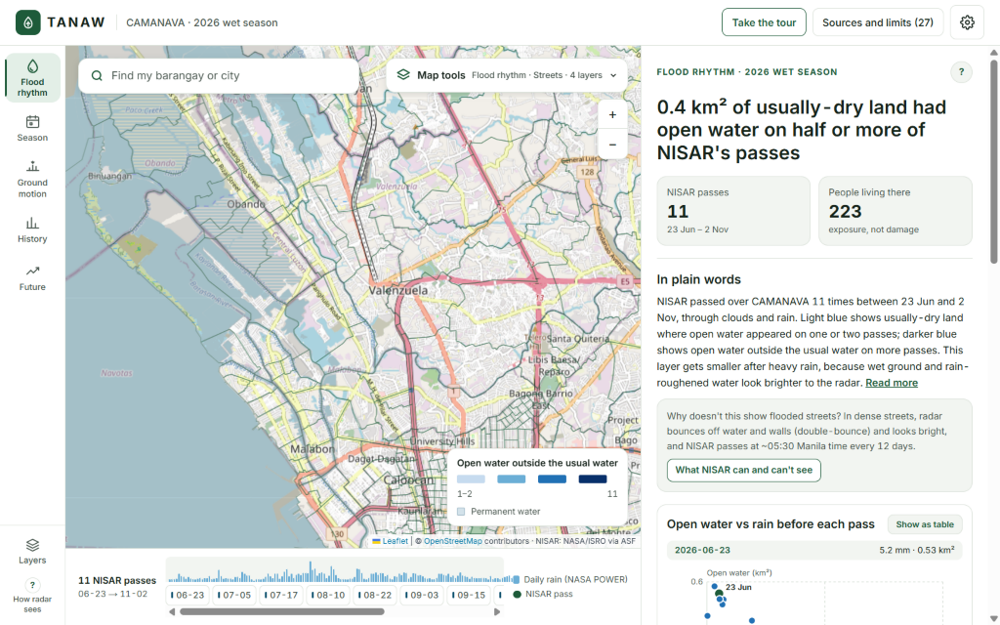
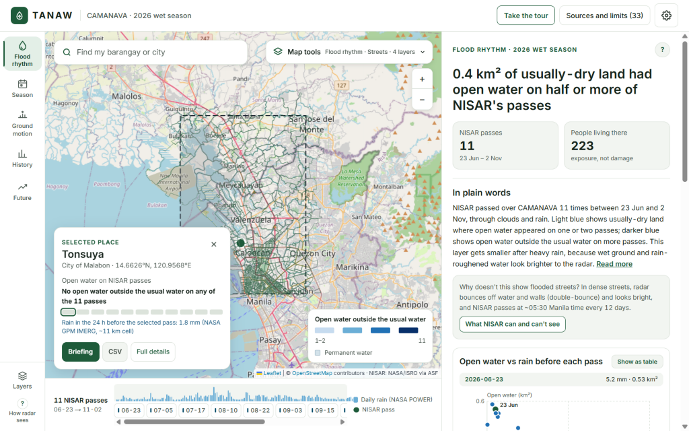

# TANAW: What NISAR Radar Sees of CAMANAVA's Floods

**NASA Space Apps Challenge 2026 · "Dancing with the SARs" · Team Project Gravensoft, Metro Manila**

*Tanaw* is Filipino for "to look, to view". Our team lives with flooding in CAMANAVA (Caloocan, Malabon, Navotas and Valenzuela) every year. We asked a simple question: **what can NASA-ISRO's new NISAR radar satellite actually see of these floods, through clouds and rain, and what can it not see yet?**

Tanaw is an interactive web app that answers this with **real NISAR data**: every pass over CAMANAVA and the Bulacan coast in the 2026 wet season, checked against rainfall and an independent satellite, and explained in English and Filipino.



---

## What we found

| | Finding | Evidence |
|---|---|---|
| ✅ **It sees** | **Recurring open water at the edges of CAMANAVA**: fishponds, paddies, wetlands and the coast. About 0.4 km² is open water on half or more of the passes, outside the usual water. | 11 NISAR passes, 23 Jun – 2 Nov 2026 |
| ✅ **It's real** | **Two separate NISAR orbits (05:30 and 18:24) find the same places.** 99% of the morning orbit's recurring water lies within 30 m of the evening orbit's; a randomly shifted map scores 0.04%. Each orbit was calibrated on its own, and the thresholds came out nearly identical (−12.5 vs −13.0 dB). | 11 + 10 passes, processed independently |
| ✅ **It agrees with another satellite** | When NISAR says "water", Sentinel-1 OPERA water maps agree **97%** of the time (median F1 0.74 over 10 same-time-of-day matches). NISAR is conservative: it misses some flooded vegetation that OPERA counts. | 13 OPERA DSWx-S1 comparisons |
| ⚠️ **It cannot see** | **Flooded city streets.** Water between buildings bounces the radar back brightly instead of looking dark, and streets are narrower than the 10 m pixels. Even evening passes 1–2 hours after afternoon thunderstorms show no street water. 0 km² of the recurring water is on built-up land. | Both orbits, with NASA GPM IMERG rain timing |
| 🔍 **Exploratory** | On morning passes, the land looks "wetter" to the radar after rain (ρ = 0.93, p < 0.001), and open water shrinks (ρ = −0.77). **This did not repeat on the evening orbit**, so we report it as exploratory, not a finding. | Permutation, bootstrap and leave-one-out tests |
| ❌ **Not yet possible** | **Ground sinking (subsidence).** Four months of NISAR interferograms are dominated by ionospheric noise. The app says so instead of showing a made-up map. | 9 NISAR GUNW pairs |

**Why it matters:** NISAR revisits every 12 days, day and night, through clouds. That is exactly when optical satellites fail during typhoons. Knowing precisely where it works (open land, fishponds, the coast) and where it doesn't yet (dense streets) is what a city, a researcher or a resident needs before trusting a satellite flood map.

---

## What you can do in the app



- **Flood rhythm:** where open water appeared, and how often, across the season.
- **Season:** step through each NISAR pass, with the rain that fell before it (NASA GPM IMERG) and a radar-polarization view.
- **Spot check:** click any place, or search your barangay, for its pass-by-pass radar history, rainfall, population exposure, a bilingual briefing and a CSV export.
- **History and Future:** NASA POWER rainfall since 2000, a seasonal outlook and conditional "what-if" rain scenarios, clearly marked as not predictions.
- **How radar sees:** a plain-language guide to why radar sees fishponds but not flooded streets.
- **Validation panel:** the Sentinel-1 agreement, the two-orbit check and every statistical test, inside the app.
- **English / Filipino**, laptop and phone, with sources and limitations one click away.

More screenshots: [docs/screenshots/current/](docs/screenshots/current/).

---

## How it addresses the challenge

| The challenge asks for | What Tanaw does |
|---|---|
| Use NISAR to track surface change | 21 real NISAR passes (two orbits), open water outside the usual water, per pass and as a season rhythm |
| An interactive app that visualizes change | Map-first web app with pass stepper, overlays, search, spot check and timelapse |
| Combine with other data | NASA GPM IMERG, NASA POWER, NASA OPERA DSWx-S1, ESA WorldCover, WorldPop, OpenStreetMap, boundaries |
| Make results understandable and actionable | Plain-language summaries, bilingual place briefings, population exposure, CSV/GeoTIFF downloads |
| Scientific validity | Independent satellite validation, a second-orbit replication, and robustness tests; failures reported as openly as successes |

---

## Try it yourself (about 15 minutes)

There is no public live demo, because free hosting cannot hold the radar data. The app runs on any laptop. **No NASA login is needed.** You need [Git](https://git-scm.com/downloads), [Python 3.12+](https://www.python.org/downloads/) and [Node.js 20](https://nodejs.org/), plus internet access for the downloads and map tiles.

**Step 1. Download the NISAR data package** (392 MB, in four parts, no sign-in): [part00](https://raw.githubusercontent.com/Jonnywik/NASA-SA-Final/data-package-v1/tanaw-data-camanava_2026-v1.zip.part00) · [part01](https://raw.githubusercontent.com/Jonnywik/NASA-SA-Final/data-package-v1/tanaw-data-camanava_2026-v1.zip.part01) · [part02](https://raw.githubusercontent.com/Jonnywik/NASA-SA-Final/data-package-v1/tanaw-data-camanava_2026-v1.zip.part02) · [part03](https://raw.githubusercontent.com/Jonnywik/NASA-SA-Final/data-package-v1/tanaw-data-camanava_2026-v1.zip.part03). Put the four files in one folder and open a terminal there.

**Step 2. Join the parts, get the code, and unpack the data**

Windows (PowerShell):
```powershell
cmd /c copy /b tanaw-data-camanava_2026-v1.zip.part00+tanaw-data-camanava_2026-v1.zip.part01+tanaw-data-camanava_2026-v1.zip.part02+tanaw-data-camanava_2026-v1.zip.part03 tanaw-data-camanava_2026-v1.zip
git clone https://github.com/Jonnywik/NASA-SA-Final.git
cd NASA-SA-Final
Expand-Archive -Path ..\tanaw-data-camanava_2026-v1.zip -DestinationPath .
```

macOS / Linux:
```bash
cat tanaw-data-camanava_2026-v1.zip.part0{0,1,2,3} > tanaw-data-camanava_2026-v1.zip
git clone https://github.com/Jonnywik/NASA-SA-Final.git
cd NASA-SA-Final
unzip ../tanaw-data-camanava_2026-v1.zip
```

Optional integrity check: the joined zip's SHA-256 is `3290a66b2fc115bd666c1f199c17c7e5d0c6f978132264eb28335219110a2cfa` (Windows: `Get-FileHash ..\tanaw-data-camanava_2026-v1.zip`; macOS: `shasum -a 256 ../tanaw-data-camanava_2026-v1.zip`; Linux: `sha256sum ../tanaw-data-camanava_2026-v1.zip`).

**Step 3. Start the backend** (first run installs packages, a few minutes)

Windows:
```powershell
python -m venv .venv
.\.venv\Scripts\python -m pip install -r backend\requirements.txt
cd backend
..\.venv\Scripts\python -m uvicorn app.main:app --port 8000
```
macOS / Linux:
```bash
python3 -m venv .venv
.venv/bin/python -m pip install -r backend/requirements.txt
cd backend && ../.venv/bin/python -m uvicorn app.main:app --port 8000
```

**Step 4. Start the app** in a second terminal, from the `NASA-SA-Final` folder:
```bash
cd frontend
npm ci
npm run dev
```

**Step 5. Open http://localhost:3000.** Try searching "Malabon", stepping through the passes, switching to Filipino in the settings (⚙), and opening **How radar sees**.

If something looks wrong:
- **"Not available yet" on the map:** the data package was not unzipped inside the `NASA-SA-Final` folder.
- **"Cannot reach the backend":** the Step 3 terminal is not running.

These steps were tested on a fresh machine from a clean GitHub clone ([record](docs/data/DATA_PACKAGE.md)).

---

## Honest limitations

- **This is not a street-flood map.** "Open water outside the usual water" is what the radar measures; a missing signal does not mean a street stayed dry.
- **Passes come every 12 days per orbit**, so floods that rise and drain between passes are missed.
- **Most NISAR products are provisional** (the mission's first season) and may be reprocessed. The water rule and the 2021 land-cover mask affect the numbers.
- **Validation is against another satellite, not ground truth.** No street-level flood observations exist for these dates.
- **Rainfall is coarse:** IMERG cells are about 11 km, and NASA POWER reads too wet in the dry season. Scenarios are what-ifs, not forecasts. WorldPop is a 2020 model, and OpenStreetMap building coverage is incomplete.
- **Ground motion and priority zones are unavailable** until a longer, ionosphere-corrected NISAR record exists.

Every number in the app carries its source, resolution and limitations.

---

## Data and credits

**NASA:** [NASA-ISRO NISAR L2 GCOV, GUNW and SME2](https://nisar-docs.asf.alaska.edu/) (via ASF DAAC) · [GPM IMERG Late Run](https://disc.gsfc.nasa.gov/datasets/GPM_3IMERGHHL_07/summary) (GES DISC) · [OPERA DSWx-S1](https://podaac.jpl.nasa.gov/dataset/OPERA_L3_DSWX-S1_V1) (PO.DAAC) · [NASA POWER](https://power.larc.nasa.gov/) · [CMR catalogue](https://cmr.earthdata.nasa.gov/search)

**Partners and others:** [ISRO](https://www.isro.gov.in/) (NISAR partner) · [Copernicus Sentinel-1](https://www.esa.int/Applications/Observing_the_Earth/Copernicus/Sentinel-1) (ESA) · [ESA WorldCover 2021](https://esa-worldcover.org/en/data-access) (CC BY 4.0) · [WorldPop 2020](https://hub.worldpop.org/geodata/summary?id=36130) (CC BY 4.0) · [HDX COD-AB boundaries](https://data.humdata.org/dataset/cod-ab-phl) · [HOT OSM buildings](https://data.humdata.org/dataset/hotosm_phl_buildings) and [OpenStreetMap](https://www.openstreetmap.org/copyright) (ODbL) · [ECMWF SEAS5 and ERA5 via Open-Meteo](https://open-meteo.com/)

Every dataset, version, checksum and licence is listed in the [data manifest](docs/data/DATA_MANIFEST.md).

**Built with:** Next.js, React, Leaflet, Recharts and Tailwind (web app); Python, FastAPI, rasterio/GDAL, NumPy, SciPy and h5py (backend and analysis).

---

## Use of AI

AI tools were used throughout this project, and we disclose how:

- **Coding, debugging and testing:** Anthropic Claude (Claude Code), OpenAI Codex and Google Antigravity wrote and reviewed most of the code under our direction. Commits made with AI carry the agent's name as author or a `Co-Authored-By` line in the git history.
- **Data analysis:** AI agents wrote and ran the analysis scripts (in [`backend/scripts/`](backend/scripts/)). **Every number in the app and this README is computed by that code from the real NASA and partner data listed above. No result was generated or estimated by an AI model.**
- **Research, writing and translation:** AI helped search NASA catalogues and documentation, draft documentation and this README, and draft the Filipino interface text, which our team reviews.
- **Ideation:** AI helped plan the scope and the design.
- **No AI-generated images** are used in the app. The screenshots are of the real app. No NASA logos or branding are used.

The coordination between our AI agents (tasks, status reports, audits) is kept in [docs/project-log/](docs/project-log/) for transparency.

---

## More detail

- [Documentation index](docs/README.md): science, validation, data, design
- [NISAR runbook](docs/NISAR_RUNBOOK.md): how every result was produced, including corrections
- [Validation](docs/science/VALIDATION.md) and [data package](docs/data/DATA_PACKAGE.md)
- [For developers](docs/DEVELOPERS.md): reprocessing from raw NISAR files, tests, API and repository layout

[MIT licence](LICENSE) · © 2026 Tanaw contributors
